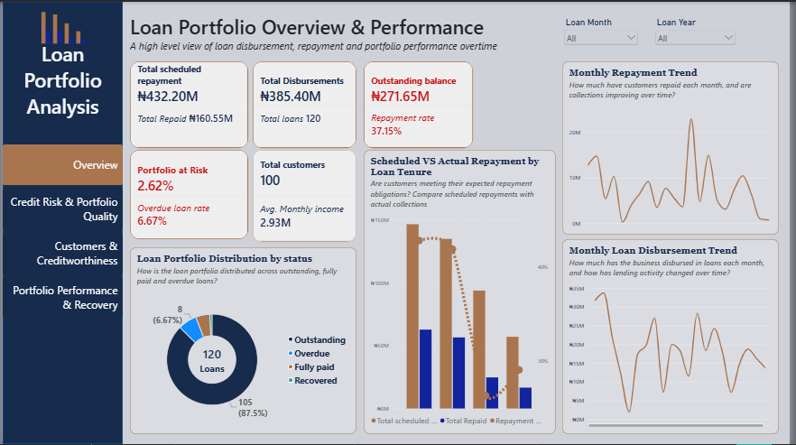
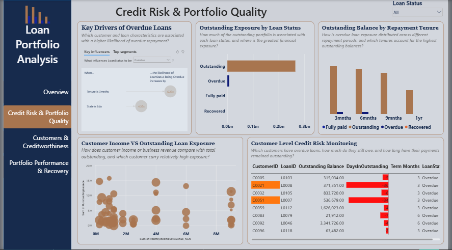

# Loan Portfolio Performance & Credit Risk Analysis

**Author:** Francis Blessing Osewayeme  
**Tools:** MySQL, Microsoft Excel, Power BI  
**Project type:** Portfolio project / credit risk and loan performance analysis

## Project overview

This project analyses a loan portfolio using customer, loan, repayment and monthly summary data. I used SQL to prepare and validate the data, Excel as the source workbook, and Power BI to structure the analysis into portfolio performance, credit risk, customer behaviour and recovery views.

## 📌 Project Navigation

Use the links below to explore the different components of this project.

| Section | Description |
|---|---|
| [📊 Project Report](Loan_Portfolio_Performance_Credit_Risk_Analysis_Report.pdf) | Read the complete project report, findings and recommendations. |
| [💻 SQL Script](loan_portfolio_project.sql) | Explore the SQL queries used for data extraction, transformation and analysis. |
| [📁 Excel Workbook](loan_portfolio_project.xlsx) | Access the dataset and supporting analysis. |
| [📈 Charts & Visualisations](charts/) | Explore the original charts generated during the analysis. |

---

## 📈 Data Visualisations

### 1. Loan Overview 

### 2. Credit Risk & Portfolio Quality 

### 3. Monthly Summary Rates

---

## 📂 Repository Structure

The repository is organised as follows:

- `README.md` – Project overview and documentation.
- `loan_portfolio_project.sql` – SQL queries used for the analysis.
- `loan_portfolio_project.xlsx` – Excel workbook and supporting data.
- `Loan_Portfolio_Performance_Credit_Risk_Analysis_Report.pdf` – Final project report.
- `.gitignore` – Git configuration file.
- `charts/` – Folder containing the project visualisations.
  - `loan_values.png`
  - `loan_status.png`
  - `monthly_summary_rates.png`

---

## Dataset contents

The supplied workbook contains five worksheets:

| Worksheet | Records | Purpose |
|---|---:|---|
| Customers | 100 | Customer profile, customer type, location, sector and income/revenue attributes |
| Loans | 120 | Loan principal, interest, term, scheduled repayment, status and outstanding balance |
| Repayments | 342 | Repayment transactions, dates, channels and references |
| Monthly_Summary | 10 | Separate monthly reporting series for disbursement, default, repayment and recovery |
| Data_Dictionary | 10 | Field definitions and notes |

**Important:** The Monthly_Summary is treated as a separate reporting series. Its period is not presented as the date range for all loan and repayment records. The loan-level and monthly-summary disbursement totals differ in the source workbook, so they are not combined.

## Key findings

- Principal disbursed at loan level: **₦385.40m**
- Scheduled repayment: **₦432.20m**
- Total repaid: **₦160.55m**
- Outstanding balance: **₦271.65m**
- Loan-level repayment rate: **37.15%**
- Loans labelled Overdue: **8 (6.67%)**
- Outstanding balance on overdue loans: **₦7.11m**
- Overdue-balance share / PAR proxy: **2.62%**

The overdue-balance share is a proxy, not a formal regulatory PAR measure, because the workbook does not specify an ageing threshold.

## SQL workflow

The SQL script includes database and table creation, staging and backup tables, data type adjustments, Excel serial-date conversion, data-quality checks, relationship validation, joins and aggregation queries.

## Power BI report structure

1. Loan Portfolio Overview & Performance
2. Credit Risk & Portfolio Quality
3. Customer Behaviour & Creditworthiness Analysis
4. Portfolio Performance & Recovery Analysis

## Repository files

- `loan_portfolio_project.sql` — SQL workflow used for the project.
- `loan_portfolio_project.xlsx` — source workbook.
- `Loan_Portfolio_Performance_Credit_Risk_Analysis_Report.pdf` — final A4 report.
- `charts/` — monochrome charts included in the report.

## How to use

1. Download or clone this repository.
2. Open `loan_portfolio_project.xlsx` to review the source data.
3. Open `loan_portfolio_project.sql` in MySQL Workbench and review/run the SQL workflow in your own MySQL environment. Adjust the file import paths and database settings if needed.
4. Open the PDF report for the methodology, findings and recommendations.

## Limitations

This is a project dataset and does not establish that it represents a live lender's complete portfolio. The formal default trigger, cure policy, ageing buckets and regulatory PAR convention are not defined in the workbook. Segment patterns and Power BI Key Influencers findings should be treated as exploratory, particularly because there are only eight loans labelled Overdue.

## Author

Francis Blessing Osewayeme  
Data Desk with Ose

## Live Power BI Dashboard

Explore the interactive report in Power BI:

[**Open the Loan Portfolio Performance & Credit Risk Dashboard**](https://app.powerbi.com/groups/me/reports/46f32505-5768-4050-83ca-133f185f6284?ctid=d4788376-10ab-4511-b638-77a63176c914&pbi_source=linkShare&bookmarkGuid=14dd57e4-07e5-4356-a502-0ad94885eab9)

> **Access note:** This is the Power BI report-sharing link you provided. Viewers may need to sign in and have permission to access the report. If you want anyone to view it without signing in, use Power BI's *Publish to web* feature only after confirming the report contains no confidential or sensitive information.
